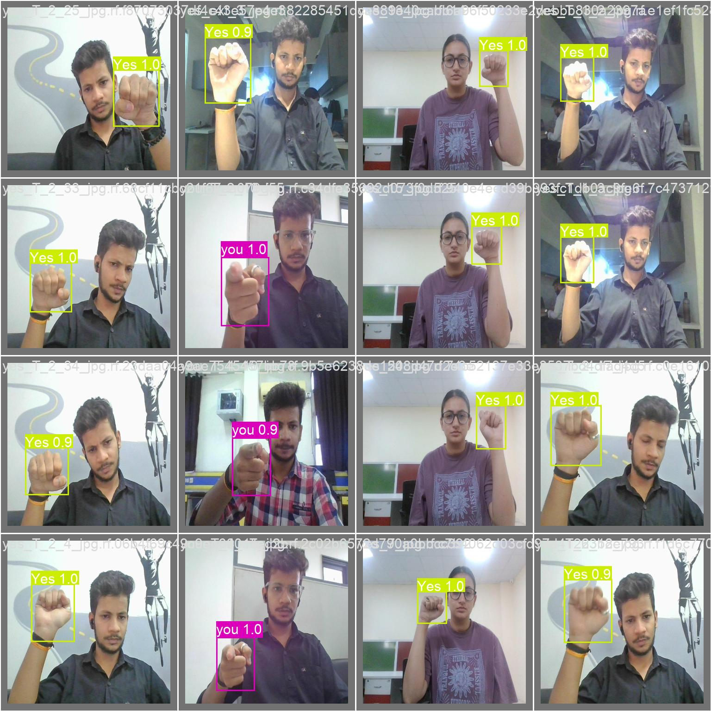
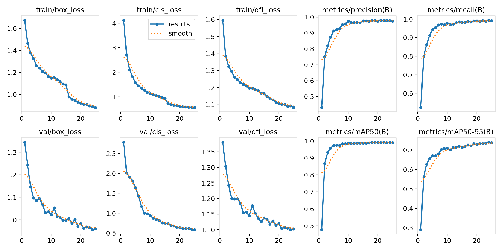
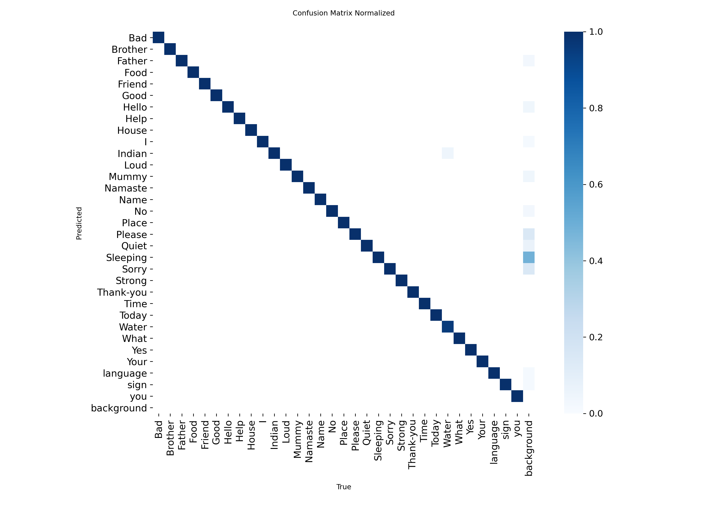

# Indian Sign Language Detection

Detects 32 common Indian Sign Language (ISL) signs in images and webcam video.
It uses a YOLOv8n object detector, fine-tuned on a public Roboflow dataset, with a small Streamlit app on top.



## What it does

- **Upload Image mode** — upload a JPG/PNG, get boxes and the sign name for every detection above 0.5 confidence.
- **Webcam mode** — runs the model on your local webcam and draws boxes live (opens an OpenCV window; press `q` to stop).

Signs (32 classes): Bad, Brother, Father, Food, Friend, Good, Hello, Help, House, I, Indian, Loud, Mummy, Namaste, Name, No, Place, Please, Quiet, Sleeping, Sorry, Strong, Thank-you, Time, Today, Water, What, Yes, Your, language, sign, you.

## Results

Trained for 25 epochs on CPU (`imgsz=350`, `batch=4`). Final validation metrics from [`runs/detect/train/results.csv`](runs/detect/train/results.csv):

| Metric | Value |
|---|---|
| Precision | 0.975 |
| Recall | 0.992 |
| mAP@50 | 0.990 |
| mAP@50-95 | 0.737 |

These are scores on the dataset's own validation split. Real-world accuracy (new people, lighting, backgrounds) will be lower.

| Training curves | Confusion matrix |
|---|---|
|  |  |

## Run it

```bash
pip install -r requirements.txt
streamlit run App.py
```

The trained weights are already in the repo at `runs/detect/train/weights/best.pt`, so you do not need to train to try the app.

## Train it yourself

1. Download the dataset in YOLO format from Roboflow Universe:
   [Indian-Sign-Language (v8)](https://universe.roboflow.com/school-fzizy/indian-sign-language-fkx1f) — 6,770 images, CC BY 4.0.
2. Edit the `train`, `val` and `test` paths in `data.yaml` to point at your download (they are currently absolute paths from the author's machine).
3. Run:

```bash
python train.py
```

This starts from `models/yolov8n.pt` and writes results to `runs/detect/train*/`.

## Files

| File | Purpose |
|---|---|
| `App.py` | Streamlit app (image upload + local webcam) |
| `train.py` | Fine-tunes YOLOv8n with Ultralytics |
| `data.yaml` | Dataset paths and the 32 class names |
| `python sign_language_detector.py` | Older Tkinter/OpenCV prototype that calls a hosted Roboflow model instead of the local weights. Needs `inference` and `supervision`, and a `ROBOFLOW_API_KEY` environment variable. |
| `runs/detect/` | Training and validation outputs: weights, curves, sample predictions |

## Limits

- Detects single static signs per frame; it does not translate full sentences or moving signs.
- The webcam mode uses `cv2.imshow`, so it only works when Streamlit runs on your own machine, not on a hosted server.
- Trained on CPU for 25 epochs only; more epochs or a bigger model (yolov8s/m) should help on harder images.

## Credits

- Dataset: Roboflow Universe user "school-fzizy", CC BY 4.0.
- Model: [Ultralytics YOLOv8](https://github.com/ultralytics/ultralytics).
