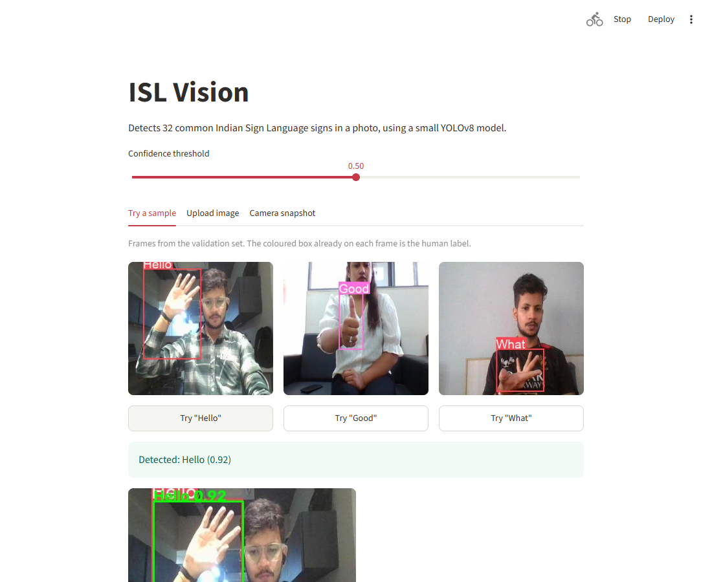

# Indian-Sign-Language-Detection

ISL Vision detects 32 common Indian Sign Language signs in a single photo. It uses a YOLOv8n model
fine-tuned on the public Roboflow
[Indian Sign Language dataset](https://universe.roboflow.com/school-fzizy/indian-sign-language-fkx1f) (CC BY 4.0).

## Live demo

<STREAMLIT_URL>

Try one of the sample photos, upload your own, or take a camera snapshot in the browser.



## Run locally

Python 3.12.

```bash
python -m venv .venv
# Windows: .venv\Scripts\activate   macOS/Linux: source .venv/bin/activate
pip install -r requirements.txt   # pulls CPU-only torch
streamlit run App.py
```

## Model

- YOLOv8n, 32 classes, 25 epochs, image size 350, trained on CPU (`train.py`).
- Validation mAP@50 0.990 at the last epoch (peak 0.993 at epoch 19), mAP@50-95 0.737.
  Source: `runs/detect/train/results.csv`.
- Limits: small dataset, a handful of signers in similar indoor rooms. It may fail on new people,
  busy backgrounds or poor light. It reads single photos, not moving signs.
